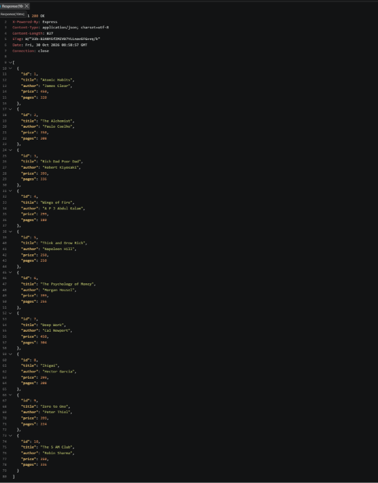
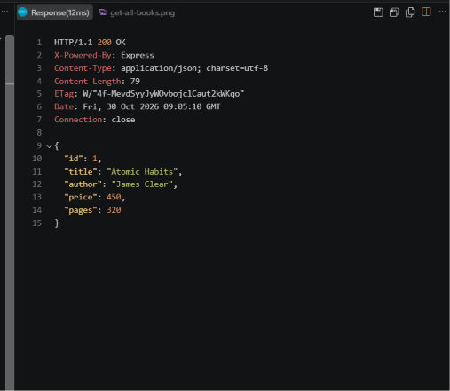
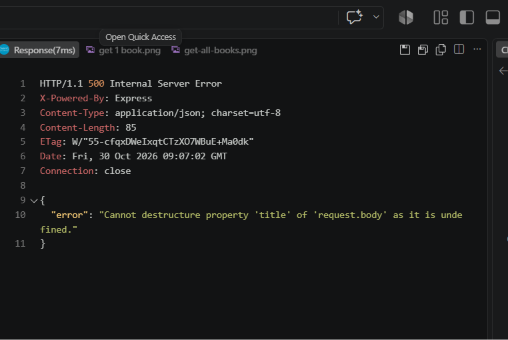
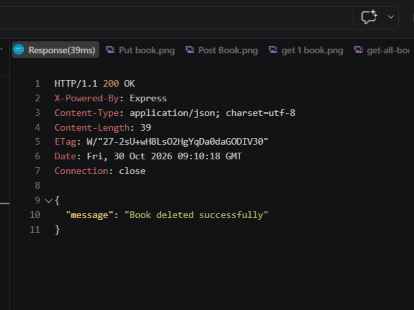
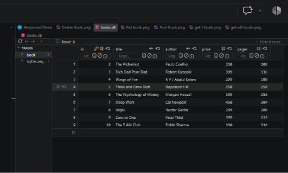

# Backend Development Fundamentals – Lab 2

## SQLite Database and CRUD Routes

A REST API for managing a collection of books, developed as part of **Backend Development Fundamentals – Lab 02**. The project uses Node.js, Express.js, and SQLite to perform Create, Read, Update, and Delete operations on book records.

---

## Student Information

| Field | Details |
|---|---|
| Lab Number | Lab 02 |
| Subject | Backend Development Fundamentals |
| Academic Year | Year II, Term II |
| Institution | NIAT x Aurora Deemed to be University |
| Faculty | Joel Prashanth D |
| Student Name | Issaku Tagarampudi |
| Registration Number | [252U1R9155] |
| Section | [CSE GENERATIVE AI ] |

## Live Deployment

**Not deployed yet**

## Project Objectives

- Create and configure an Express.js web server.
- Connect a Node.js application to a SQLite database.
- Create a database table and initialize it with sample records.
- Implement REST API routes for all CRUD operations.
- Test API endpoints using Postman.
- Use parameterized SQL queries to safely handle user input.
- Return appropriate HTTP status codes and JSON responses.

## Technologies Used

| Technology | Purpose |
|---|---|
| Node.js | JavaScript runtime environment |
| Express.js | REST API routing and middleware |
| SQLite | Lightweight relational database |
| sqlite3 | SQLite database driver for Node.js |
| JavaScript | Application development language |
| Nodemon | Automatically restarts the server during development |
| Postman | API testing and request documentation |

## Folder Structure

```text
LAB 2 BACKEND/
├── server.js
├── package.json
├── package-lock.json
├── books.db
├── app.http
├── README.md
└── screenshots/
    ├── server-running.png
    ├── get-all-books.png
    ├── get-single-book.png
    ├── post-book.png
    ├── put-book.png
    ├── delete-book.png
    └── sqlite-database.png
```

The `books.db` database file is created automatically when the application starts.

## Database Schema

Table name: `book`

```sql
CREATE TABLE IF NOT EXISTS book (
  id INTEGER PRIMARY KEY AUTOINCREMENT,
  title TEXT NOT NULL,
  author TEXT NOT NULL,
  price INTEGER,
  pages INTEGER
);
```

| Column | Type | Description |
|---|---|---|
| `id` | INTEGER | Primary key, automatically generated |
| `title` | TEXT | Book title; cannot be null |
| `author` | TEXT | Author name; cannot be null |
| `price` | INTEGER | Book price |
| `pages` | INTEGER | Total number of pages |

When the table is empty, the application automatically inserts 10 sample books.

## Installation Prerequisites

Ensure the following software is installed:

- Node.js version 18 or later
- npm, included with Node.js
- Visual Studio Code or another code editor
- Postman Desktop or the Postman VS Code extension

## Installation

1. Open the project folder in Visual Studio Code.
2. Open the integrated terminal.
3. Install the required dependencies:

```bash
npm install
```

4. Start the development server:

```bash
npm run dev
```

The server will run at:

```text
http://localhost:3000/
```

## API Endpoints

Base URL: `http://localhost:3000`

| Method | Endpoint | Description |
|---|---|---|
| GET | `/books/` | Retrieve all books |
| GET | `/books/:bookId/` | Retrieve a specific book by ID |
| POST | `/books/` | Add a new book |
| PUT | `/books/:bookId/` | Update an existing book |
| DELETE | `/books/:bookId/` | Delete a book |

### POST Request Body

```json
{
  "title": "Clean Code",
  "author": "Robert C. Martin",
  "price": 499,
  "pages": 464
}
```

### PUT Request Body

```json
{
  "title": "Clean Code",
  "author": "Robert C. Martin",
  "price": 550,
  "pages": 464
}
```

## Example API Requests and Responses

### Get All Books

**Request:**

```http
GET http://localhost:3000/books/
```

**Response: `200 OK`**

```json
[
  {
    "id": 1,
    "title": "Atomic Habits",
    "author": "James Clear",
    "price": 450,
    "pages": 320
  }
]
```

### Get a Single Book

**Request:**

```http
GET http://localhost:3000/books/1/
```

**Response: `200 OK`**

```json
{
  "id": 1,
  "title": "Atomic Habits",
  "author": "James Clear",
  "price": 450,
  "pages": 320
}
```

### Add a Book

**Request:**

```http
POST http://localhost:3000/books/
Content-Type: application/json
```

```json
{
  "title": "Clean Code",
  "author": "Robert C. Martin",
  "price": 499,
  "pages": 464
}
```

**Response: `201 Created`**

```json
{
  "message": "Book added successfully",
  "bookId": 11
}
```

### Update a Book

**Request:**

```http
PUT http://localhost:3000/books/11/
Content-Type: application/json
```

```json
{
  "title": "Clean Code",
  "author": "Robert C. Martin",
  "price": 550,
  "pages": 464
}
```

**Response: `200 OK`**

```json
{
  "message": "Book updated successfully"
}
```

### Delete a Book

**Request:**

```http
DELETE http://localhost:3000/books/11/
```

**Response: `200 OK`**

```json
{
  "message": "Book deleted successfully"
}
```

## Testing with Postman

1. Start the server with `npm run dev`.
2. Open Postman and select **New > HTTP Request**.
3. Enter the base URL `http://localhost:3000`.
4. Test retrieval using `GET /books/`.
5. Test a single book using `GET /books/1/`.
6. For `POST`, select **POST**, set the URL to `/books/`, open **Body**, choose **raw**, and select **JSON**.
7. Enter a JSON body and select **Send**.
8. For `PUT`, select **PUT**, enter `/books/:bookId/` with an existing ID, add the JSON body, and send the request.
9. For `DELETE`, select **DELETE**, enter `/books/:bookId/`, and send the request.
10. Verify successful database changes using GET requests or SQLite database tools.

## Screenshots

### Server Running


### Get All Books



### Get a Single Book



### Add a Book



### Update a Book


### Delete a Book



### SQLite Database



## SQL Injection Prevention

The application uses parameterized queries with placeholders (`?`) instead of directly combining request values into SQL statements.

For example:

```javascript
const book = await db.get(
  "SELECT * FROM book WHERE id = ?",
  [bookId]
);
```

Similarly, create, update, and delete operations use parameter arrays. This prevents user-controlled input from being interpreted as executable SQL syntax and helps protect the database from SQL injection attacks. Input validation is also performed before inserting or updating records.

## HTTP Status Codes

| Code | Meaning | Typical Use in This API |
|---|---|---|
| `200 OK` | Request succeeded | Retrieve, update, or delete a book |
| `201 Created` | Resource created successfully | Add a new book |
| `400 Bad Request` | Request data is invalid | Missing fields or invalid values |
| `404 Not Found` | Resource does not exist | Unknown book ID |
| `500 Internal Server Error` | Server or database error occurred | Database operation failure |

## Challenges Faced and Solutions

| Challenge | Solution |
|---|---|
| SQLite database initialization timing | The database connection and table setup complete before the Express server starts listening. |
| Avoiding duplicate sample data | Sample books are inserted only when the `book` table contains no records. |
| Handling invalid API input | Request bodies are validated for required fields and integer values. |
| Preventing invalid SQL values | Parameterized queries are used with user values passed separately from SQL statements. |
| Handling missing books | The API checks database results and returns a clear `404 Not Found` response. |
| Finding development errors | Nodemon automatically restarts the server whenever source files change. |

## Learning Outcomes

- Configured a Node.js and Express.js server.
- Connected an application to SQLite using the `sqlite` and `sqlite3` packages.
- Created and populated a database table programmatically.
- Designed RESTful API endpoints.
- Implemented complete CRUD functionality.
- Tested requests and responses with Postman.
- Applied JSON request validation.
- Used parameterized queries to reduce SQL injection risks.
- Returned appropriate HTTP status codes and error messages.

## Author

**Issaku Tagarampudi**

Backend Development Fundamentals – Lab 02  
NIAT x Aurora Deemed to be University
